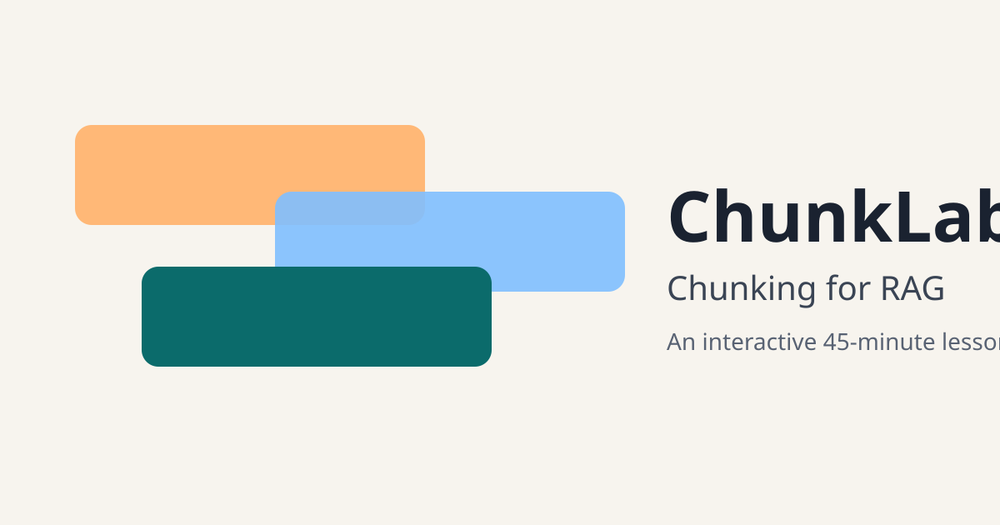

# ChunkLab: Chunking for RAG

An interactive, 45-minute lesson on **text chunking and document processing for Retrieval-Augmented Generation (RAG)**. Learners see why a RAG chatbot gives a confidently wrong answer, learn the theory in short sections, experiment in a live chunking playground with a retrieval tester, fix a broken bot in hands-on challenges, and finish with a scored quiz and flashcards.

**Live demo:** https://advikaaaa.github.io/rag-chunking-lab/


<!-- Replace with a screenshot or GIF of the Chunk Lab once deployed. -->

## Learning objectives

By the end of the lesson, learners can:

1. Explain why RAG systems split documents into chunks, and what chunk size and overlap trade off.
2. Compare five chunking strategies (fixed-size, sentence, recursive, structure-aware, semantic) and pick one for a document type.
3. Clean and structure raw documents (PDF extracts, tables, headings) before chunking.
4. Diagnose retrieval failures caused by chunking, and fix them.
5. Measure chunking quality with an evaluation set and hit rate@k.

## 45-minute lesson plan

| # | Section | Time | What happens |
|---|---|---|---|
| 0 | Start here | 1 min | Objectives and how to use the page |
| 1 | Why did the bot get it wrong? | 2 min | A support bot denies a valid refund; the retrieved chunk was cut mid-rule |
| 2 | What chunking is and why we need it | 6 min | RAG pipeline diagram, live tokenizer, chunk-size slider, overlap |
| 3 | Chunking strategies | 5 min | Five strategies, each previewed live on the same snippet |
| 4 | Document processing | 5 min | Parsing, cleaning (interactive demo), structure, metadata |
| 5 | Chunk Lab | 10 min | Playground: strategies, sliders, retrieval tester, hit-rate evaluation, compare mode, export as code |
| 6 | Fix the Bot | 8 min | 3 required challenges and 1 bonus, with pass/fail tests and progressive hints |
| 7 | Use it in your app | 5 min | Decision guide, tuning loop, code, real-world scenarios, common mistakes |
| 8 | Quiz and flashcards | 3 min (+ optional) | 8 scored MCQs with explanations; study and 60-second quick-fire flashcards |
| 9 | Summary | 1 min | Key takeaways and what to learn next |

## How to use it

**Self-learners:** read top to bottom and do every "Try it" box. Click any word with a dotted underline to open its glossary entry (definition, where it fits in the RAG pipeline, an example and related terms). Progress is saved in your browser.

**Instructors:** turn on presenter mode (screen icon in the top bar) for larger text. Suggested talking points:

- **Hook:** ask the class to guess why the bot was wrong before revealing the chunk.
- **Theory:** drag the trade-off slider live from "too small" through "about right" to "too big".
- **Strategies:** compare the five previews of the same snippet. Where does each one cut?
- **Processing:** toggle the cleaning steps one by one and watch the token count drop.
- **Chunk Lab:** run the three "Try it" experiments together; use compare mode on the pricing page.
- **Fix the Bot:** let learners attempt the challenges in pairs, then discuss which fix suits which failure.
- **Apply:** walk through the decision guide for a document type from your learners' own work.

## Run locally

ES modules don't load from `file://`, so serve the folder with any static server:

```bash
python -m http.server 8000
# then open http://localhost:8000
```

No build step and no install are needed to view the site.

## Run the tests

```bash
node tests/run.mjs          # uses the ~4 chars/token fallback tokenizer
npm install && npm test     # also runs everything with the real cl100k_base tokenizer
```

The tests cover:

- **Every chunker on every sample document:** no text lost, chunks within the size limit (except tables/code kept whole on purpose), deterministic output, and overlap smaller than the chunk size.
- **Each challenge:** the starting settings fail and every listed fix passes, under both tokenizers.
- **Cleaning, BM25, gold-span matching, semantic breakpoints** (with fake embeddings), and the content data files.

## Deploy to GitHub Pages

1. Push the repository to GitHub.
2. Go to **Settings → Pages**.
3. Under **Build and deployment**, choose **Deploy from a branch**, then select `main` and `/ (root)`.

All paths are relative, so the site works from `https://<user>.github.io/rag-chunking-lab/`.

## Project structure

```
index.html            lesson content and layout
css/styles.css        design tokens (light/dark) and components
js/
  main.js             start-up, theme, progress, inline demos
  config.js           site title (rename here)
  chunkers.js         pure chunking functions (5 strategies)
  tokenizer.js        js-tiktoken loader with a chars/4 fallback
  retrieval.js        BM25, cosine ranking, gold-span checks, hit rate@k, MRR
  cleaning.js         header/footer removal, hyphenation repair, whitespace
  challenge-core.js   pass/fail logic shared by the UI and the tests
  semantic.js         lazy Transformers.js embedding model
  playground.js       Chunk Lab UI
  challenges.js       Fix-the-Bot UI
  glossary.js         glossary drawer
  quiz.js, flashcards.js
  codegen.js          "Export as code" snippets
  ui.js, highlight.js small helpers and a tiny syntax highlighter
data/                 documents (+ gold answers), challenges, glossary, quiz, flashcards, guide
tests/run.mjs         Node test runner (no framework)
```

## Technology

- Plain HTML, CSS and JavaScript (ES modules). No framework, no build step.
- [js-tiktoken](https://www.npmjs.com/package/js-tiktoken) (`cl100k_base`) from jsDelivr for real token counts. If it can't load, counts fall back to characters ÷ 4 and are labelled "approximate".
- [Transformers.js](https://www.npmjs.com/package/@huggingface/transformers) with `Xenova/all-MiniLM-L6-v2`, loaded **only** when a learner chooses semantic chunking. The download is about 25 MB, and the page asks before downloading.
- `Intl.Segmenter` for sentence splitting, with a regex fallback.
- Fonts from Google Fonts (Bricolage Grotesque, Atkinson Hyperlegible, JetBrains Mono), with system-font fallbacks.

## Accessibility

- Semantic HTML, a skip link, labelled controls, and full keyboard support: sliders, tabs (arrow keys), quiz radios, and flashcards (Space/Enter to flip, arrows to move).
- The glossary drawer is a modal dialog: focus is trapped inside, `Esc` closes it, and focus returns to the link that opened it.
- Chunk colours are never the only signal: every chunk has a numbered badge, overlap is hatched, and colours were checked so neighbouring chunks stay distinguishable for colour-blind readers.
- Light and dark themes (following the system setting, with a toggle that's remembered), visible focus rings, WCAG AA text contrast, `prefers-reduced-motion` support (the card flip becomes an instant swap), and forced-colours support.
- Responsive: on phones the contents become a drop-down menu, the glossary becomes a bottom sheet, and the playground stacks vertically.

## Design decisions

| Element | Why it exists | What it teaches |
|---|---|---|
| Wrong-answer hook | Starts from a failure learners recognise | The LLM can only answer from what chunking lets retrieval return |
| Live tokenizer | "Tokens" is abstract until you see them | Limits are counted in tokens; ~4 chars/token is only a rough rule |
| Chunk-size slider with verdict | Makes the trade-off concrete and visible | Too small loses context; too big dilutes relevance |
| Strategy previews | Same text, five chunkers, side by side | Where each strategy is "allowed" to cut |
| Cleaning demo | Processing is invisible in most tutorials | Noise costs tokens and breaks keyword matches |
| Chunk Lab + retrieval tester | Free exploration with immediate feedback | Chunking is judged by retrieval, not by looks |
| Gold answers + hit rate@k | Introduces evaluation early | Measure retrieval instead of guessing |
| Compare mode | Two configs on one question | Trade-offs are relative; compare, don't assume |
| Export as code | Bridges the lab and real projects | How the settings map to `langchain-text-splitters` |
| Fix-the-Bot challenges | Deliberate practice with clear pass/fail rules | Diagnose the failure, then choose the matching fix |
| Glossary drawer | Depth on demand without cluttering the lesson | Vocabulary across the whole RAG pipeline |
| Quiz + flashcards | Retrieval practice and spaced review | Consolidates the key ideas; points back to sections to review |

Technical notes: retrieval in the lab is BM25 (k1 = 1.5, b = 0.75, lowercase tokens, a small stopword list and simple plural folding). Real systems often use embeddings or a hybrid of the two; the chunking lessons apply either way. Chunk sizes in the lesson are presented as starting points to tune, not rules. NimbusDesk and ACME Corp are fictional.

## Author

**Advika Awasthi**: [GitHub](https://github.com/advikaaaa) · [LinkedIn](https://www.linkedin.com/in/advika-awasthi)

## License

[MIT](LICENSE) © 2026 Advika Awasthi
